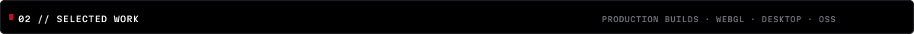
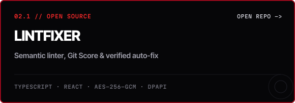
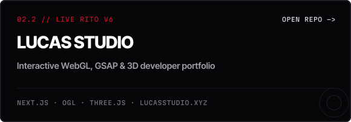
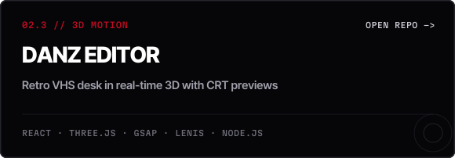
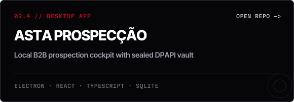
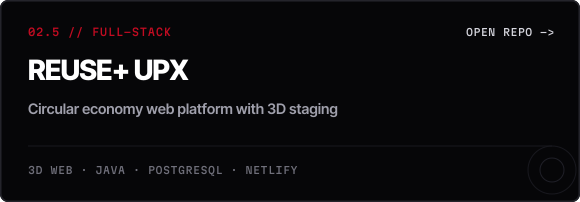
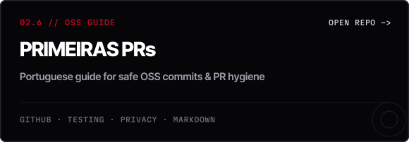
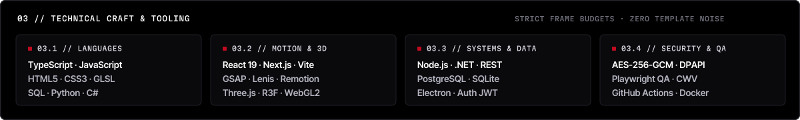
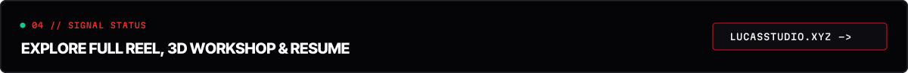

  

  
  

  
  

  
  

 

  

  

  <a href="https://lucasstudio.xyz/"><strong>lucasstudio.xyz</strong></a>
  &nbsp;·&nbsp;
  <a href="https://www.linkedin.com/in/lucashenriquemelobarbosa/">LinkedIn</a>
  &nbsp;·&nbsp;
  <a href="https://x.com/vcenovra">X (@vcenovra)</a>
  &nbsp;·&nbsp;
  <a href="https://www.instagram.com/oylucs/">Instagram (@oylucs)</a>
  &nbsp;·&nbsp;
  <a href="https://github.com/lucshllw?tab=repositories">Repositories</a>

